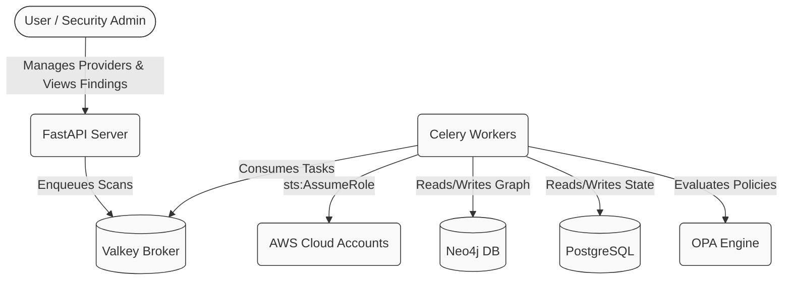
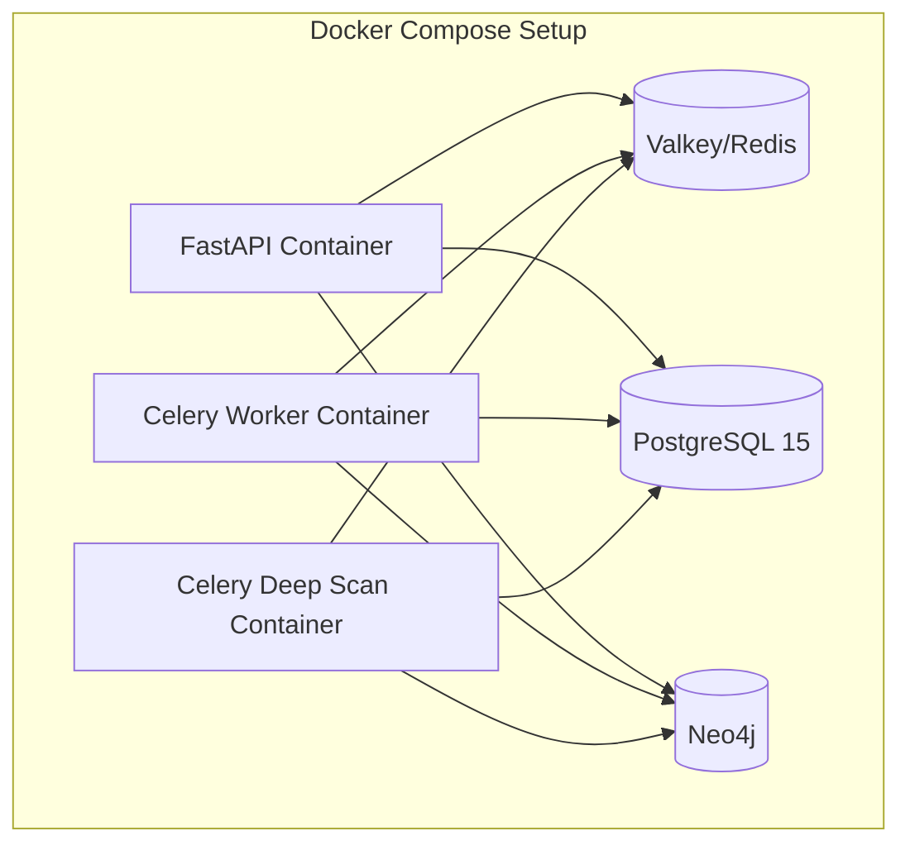
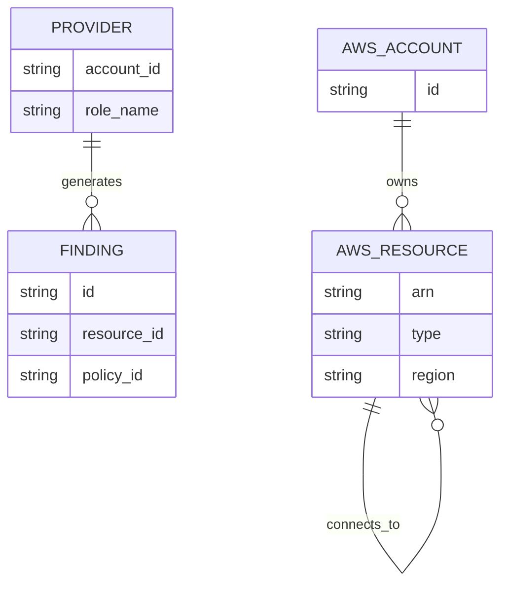

# 01 Architecture Overview

## Table of Contents
1. [TL;DR](#tldr)
2. [Purpose](#purpose)
3. [Tech Inventory](#tech-inventory)
4. [Folder Map](#folder-map)
5. [Authentication & Cross-Account Access](#authentication--cross-account-access)
6. [Deployment](#deployment)
7. [System Diagrams](#system-diagrams)

## TL;DR
- **CloudSecure** is an integrated Cloud Security Posture Management (CSPM) tool supporting both delta (fast) and deep (thorough) scans.
- Uses **Python 3.11 (FastAPI)** for the core API and **Celery** for background task execution.
- Stores graph relationships in **Neo4j** and relational/state data in **PostgreSQL 15**.
- Implements **OPA (Open Policy Agent)** for policy evaluation.
- Utilizes AWS `sts:AssumeRole` to perform cross-account scanning.

## Purpose
CloudSecure is an open-source Cloud Security Posture Management (CSPM) tool designed to inventory cloud resources, build relationship graphs, and evaluate security postures using OPA policies. It uniquely combines rapid incremental delta scans (using AWS Config and CloudTrail) with exhaustive deep scans (using Cartography).

## Tech Inventory

| Tool | Version | Where Used / File | Why Used |
|------|---------|-------------------|----------|
| Python | 3.11 | `backend-fastapi/Dockerfile` | Core language for API and workers. |
| FastAPI | (via reqs) | `backend-fastapi/app/` | High-performance async web framework for the API. |
| Celery | (via reqs) | `backend-fastapi/worker/celery_app.py` | Distributed task queue for running background scans. |
| PostgreSQL | 15 | `docker-compose.yml` | Stores user, provider, and scan state/metadata. |
| Neo4j | (via reqs) | `backend-fastapi/worker/jobs/inventory/neo4j_writer.py` | Graph database to map resource relationships (and Graph Data Science extensions). |
| Valkey / Redis | latest | `docker-compose.yml` | Broker for Celery tasks. |
| Open Policy Agent (OPA) | (via reqs) | `backend-fastapi/worker/jobs/rule_engine/` | Policy-as-code engine for security posture evaluation. |
| Cartography | (via reqs) | `backend-fastapi/worker/jobs/deep_scan/` | Exhaustive AWS resource mapping and deep ingestion module. |

## Folder Map

```text
c:\CloudSecure_Oct2026\cloudsecure-kalitopi\
├── backend/                  # Legacy or alternate backend codebase (Not explored)
├── backend-fastapi/          # Main Python Backend (FastAPI + Celery)
│   ├── app/                  # FastAPI routers, models, schemas, and core config
│   ├── worker/               # Celery app and jobs (deep_scan, inventory, rule_engine)
│   ├── scripts/              # Helper scripts and utilities
│   └── requirements-*.txt    # Python dependencies per service type
├── Cloudsecure_cli/          # Command Line Interface tool
├── frontend/                 # Web UI (React/NextJS assumed)
├── IaC_backend/              # Infrastructure as Code templates for backend
├── docs/                     # Technical documentation
└── docker-compose.yml        # Local deployment orchestration
```

## Authentication & Cross-Account Access
Cross-account access in AWS is achieved via the standard `sts:AssumeRole` mechanism. The application authenticates dynamically to target accounts rather than relying on long-lived credentials for each target.

- **Implementation Location:** `backend-fastapi/worker/jobs/inventory/config.py:L15-L29`
- **Method:** `boto3.client("sts").assume_role(...)`
- **Mechanism:** The worker assumes a pre-configured IAM role (e.g., `CloudSecureInventory`) in the target `account_id` for a duration of 3600 seconds, and uses the resulting temporary credentials to initialize a `boto3.Session`. 
- **Backoff & Rate Limiting:** Boto3 clients are configured with an adaptive retry mode and max attempts of 8 to handle throttling seamlessly.

## Deployment
Deployment is orchestrated via Docker Compose (`docker-compose.yml`), making it easy to run locally or on a single host.

- Contains distinct services for `db` (PostgreSQL), `valkey` (Task broker), and presumably API/Worker containers built from `backend-fastapi/Dockerfile`.
- The `Dockerfile` handles environment-specific builds (e.g., core vs deep-scan) by using different requirements files (`requirements-core.txt`, `requirements-deep.txt`).

## System Diagrams

### System Context Diagram

*System Context: The API acts as the primary interface, offloading resource-intensive scans and rule evaluations to Celery workers, which map data into Neo4j and PostgreSQL.*

### Container Diagram

*Container Architecture: Separate worker containers can be scaled independently for core ingestion (delta) versus exhaustive deep scans, all communicating with the shared datastores.*

### Datastore Entity-Relationship Diagram (High Level)

*Datastore ER: PostgreSQL acts as the source of truth for configuration and findings (Providers, Findings), while Neo4j maps the topological layout and connections of the AWS environment.*
