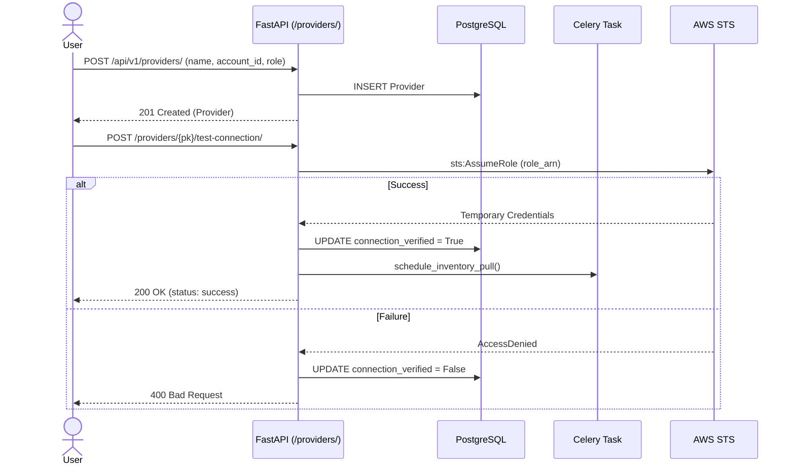
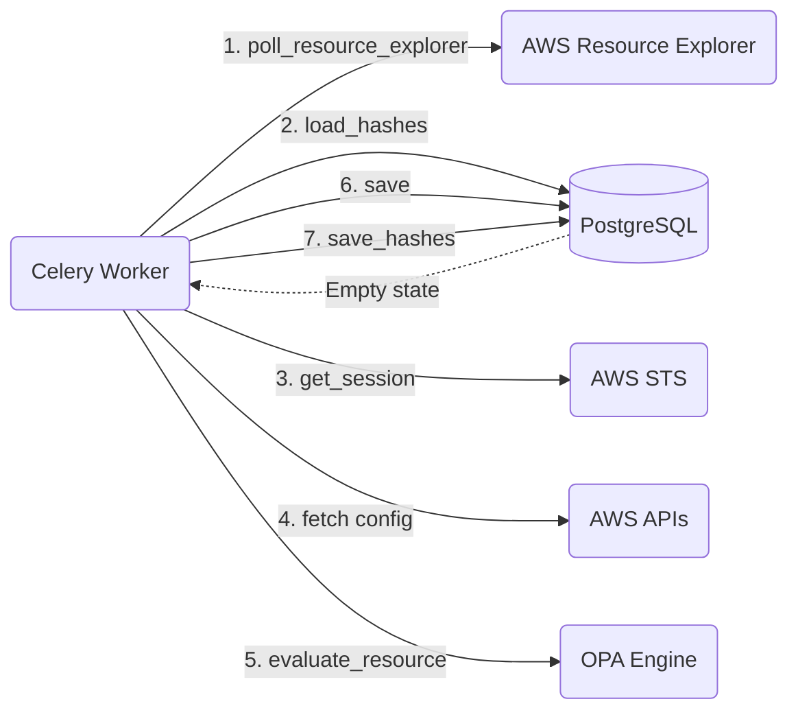
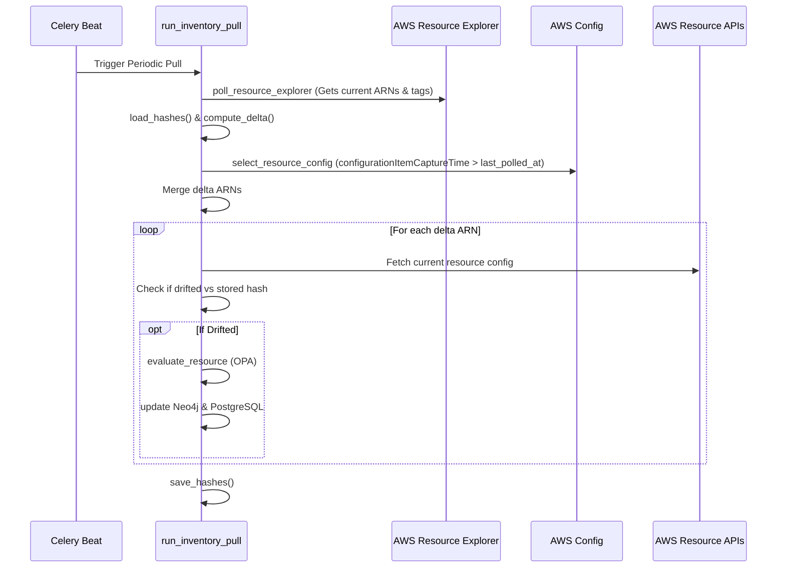
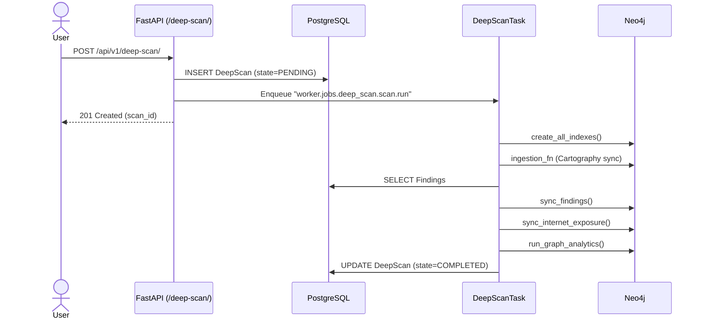
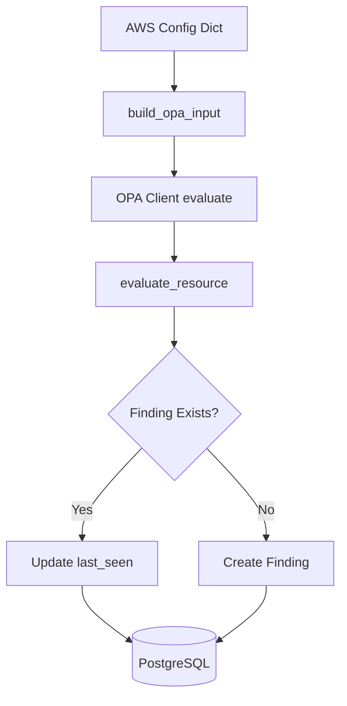

# 02 Data Flow Diagrams (Part 1 & 2)

## Table of Contents
1. [TL;DR](#tldr)
2. [Onboarding Flow](#onboarding-flow)
3. [Full Scan (Initial Run)](#full-scan-initial-run)
4. [Delta Scan (Scheduled)](#delta-scan-scheduled)
5. [Delta Scan (Event-Driven)](#delta-scan-event-driven)
6. [Deep Scan Flow](#deep-scan-flow)
7. [Policy Evaluation & Findings Lifecycle](#policy-evaluation--findings-lifecycle)
8. [API Reads (Graph Analytics)](#api-reads-graph-analytics)
9. [Notifications](#notifications)

## TL;DR
- **Onboarding** registers a Provider in PostgreSQL and triggers a connection test via `sts:AssumeRole`.
- **Full Scan** conceptually represents the first run of the Delta Scan, where the local state hashes are empty, causing all resources to be fetched and evaluated.
- **Delta Scan (Scheduled)** runs periodically via Celery Beat, using AWS Resource Explorer (for tag/existence drift) and AWS Config (for configuration drift) to only fetch changed resources.
- **Deep Scan** performs an exhaustive mapping of cloud assets into Neo4j via Cartography, manually triggered via the API.
- **Policy Evaluation** uses OPA/Rego internally on the fetched config, creating findings in PostgreSQL.
- **Delta Scan (Event-Driven)** and **Notifications** are **not found in the codebase**.

## Onboarding Flow

**Purpose:** Register a new AWS account (Provider) and verify cross-account access.

### Sequence Diagram

### Flow & Citations
1. **Creation:** User submits provider details. API saves to DB (`backend-fastapi/app/api/routers/providers.py:L36-57`).
2. **Verification:** User requests a connection test. API calls `sts.assume_role` synchronously (`providers.py:L83-114`).
3. **Scheduling:** On success, `schedule_inventory_pull` is called to add the provider to the scheduled Valkey queue for recurring scans (`providers.py:L98`).

### Payload & Failure Modes
- **Payload:** `{"name": "Prod", "aws_account_id": "123456789012", "inventory_role_name": "CloudSecureRole", "active": true}`
- **Failure Modes:** IAM role doesn't exist, Trust Policy is missing (results in AWS ClientError mapped to 400 Bad Request).

## Full Scan (Initial Run)

**Purpose:** The first time an inventory pull runs, it acts as a "Full Scan" because no prior state exists.

### Data Flow Diagram

### Flow & Citations
1. **Trigger:** `periodic_inventory_pulls` runs `perform_inventory_pull_task` (`worker/tasks.py:L52-64`).
2. **Resource Discovery:** `poll_resource_explorer` retrieves all current ARNs (`worker/jobs/inventory/aws.py:L326`).
3. **Delta Calculation:** `load_hashes` returns empty. The `compute_delta` function categorizes all ARNs as `"new"` (`worker/jobs/inventory/aws.py:L334-336`).
4. **Fetching & Evaluation:** Every resource is fetched via specific API calls (e.g. `s3.py`, `iam.py`), evaluated against OPA, and saved to DB and Neo4j (`worker/jobs/inventory/aws.py:L368-464`).

## Delta Scan (Scheduled)

**Purpose:** Efficiently identify and evaluate only changed resources.

### Sequence Diagram

### Flow & Citations
1. **Discover Baseline:** Uses AWS Resource Explorer to get a quick snapshot of all ARNs and their tags. Compares against `previous_hashes` to find tag changes or deleted resources (`worker/jobs/inventory/aws.py:L326-337`).
2. **Discover Drift:** Queries AWS Config (`select_resource_config`) for configuration drift since the last polling timestamp (`worker/jobs/inventory/aws.py:L339-355` & `config_drift.py:L30-61`).
3. **Targeted Fetching:** Iterates *only* over the merged delta ARNs, fetching their full configuration using service-specific fetchers (`worker/jobs/inventory/aws.py:L368-395`).
4. **Drift Verification:** Computes a strict hash (`compute_config_hash`) of the fetched config to eliminate false positives before writing updates or triggering OPA evaluations (`worker/jobs/inventory/aws.py:L398-451`).
5. **Re-evaluation:** Optionally re-evaluates unchanged resources against newly updated rules (`worker/jobs/inventory/aws.py:L477-480`).

### Failure Modes
- `poll_resource_explorer` fails: The scan aborts to prevent falsely marking resources as deleted.
- Missing Fetcher: Unrecognized resource types are skipped (`skipped_no_fetcher`), and their hashes are carried forward.
- Fetch API failure: Resource is marked as `fetch_failed` and its state is not updated, allowing it to be retried on the next run.

## Delta Scan (Event-Driven)
**Not found in codebase:** Searched for AWS EventBridge, SQS queues, SNS topics, Webhooks, or CloudTrail event ingestion pipelines that would trigger immediate delta scans on specific events. All delta scanning relies on the scheduled polling mechanism in Celery Beat.

## Deep Scan Flow

**Purpose:** Manual trigger for exhaustively mapping all resources and their relationships using Cartography into Neo4j.

### Sequence Diagram

### Flow & Citations
1. **Trigger:** User manually triggers the API (`backend-fastapi/app/api/routers/deep_scan.py:L25-46`).
2. **Cartography Ingestion:** The worker calls the ingestion function (Cartography) to deeply map all AWS resources (`worker/jobs/deep_scan/scan.py:L62-69`).
3. **Overlay Findings:** PostgreSQL findings generated during delta scans are synced into the Neo4j graph as relationships on the resource nodes (`worker/jobs/deep_scan/scan.py:L71-79`, `worker/jobs/deep_scan/findings.py:L21-42`).
4. **Graph Data Science:** Internet exposure and graph analytics (e.g. attack paths) are computed over the newly built Neo4j graph (`worker/jobs/deep_scan/scan.py:L81-90`).

### Payload & Failure Modes
- **Payload:** `{"provider_id": 123}`
- **Failure Modes:** Neo4j unreachable, Cartography ingestion fails (e.g. AWS throttling), OOM on Celery worker.

## Policy Evaluation & Findings Lifecycle

**Purpose:** Evaluate configuration against Open Policy Agent (OPA) and store the resulting findings in PostgreSQL.

### Data Flow Diagram

### Flow & Citations
1. **Input Generation:** `evaluate_resource` takes the raw AWS config and tags and converts it into a standard JSON input shape via `build_opa_input` (`worker/jobs/rule_engine/evaluator.py:L173`).
2. **OPA Evaluation:** The OPA client runs against pre-loaded `.rego` policies (e.g. `cloudsecure.rules.cis_aws_s3`) and returns an array of denial messages (`worker/jobs/rule_engine/evaluator.py:L181`).
3. **Validation Probes:** Custom Python logic (e.g., verifying if public S3 buckets are actually publicly accessible via anonymous requests) acts as a secondary verification probe to reduce false positives (`worker/jobs/rule_engine/evaluator.py:L214`).
4. **Lifecycle Updates:** 
   - New denials are created in PostgreSQL (`repo.create_finding`).
   - Existing denials have their `last_seen` timestamp updated (`worker/jobs/rule_engine/evaluator.py:L217-248`).
   - Missing denials (when resources become compliant or are deleted) are later closed by a cleanup task (likely checking stale `last_seen` timestamps).

## API Reads (Graph Analytics)

**Purpose:** Frontend UI retrieving graph layouts, attack paths, and inventory summaries.

### Flow & Citations
1. **Trigger:** `GET /api/v1/providers/{provider_id}/graph/` (`app/api/routers/analytics.py:L35-43`).
2. **Service Layer:** Calls `graph_service.inventory_graph_data`, which queries Neo4j via Cypher to generate D3.js compatible node/link structures for the frontend.
3. **Payload:** Returns a JSON structure describing nodes (`id`, `label`, `properties`) and links (`source`, `target`, `type`).

## Notifications

**Not found in codebase:** Searched for Slack, SNS, Email, PagerDuty, or generalized `notification` modules. Currently, findings are generated and stored, but there is no proactive outbound notification or alerting system present.
