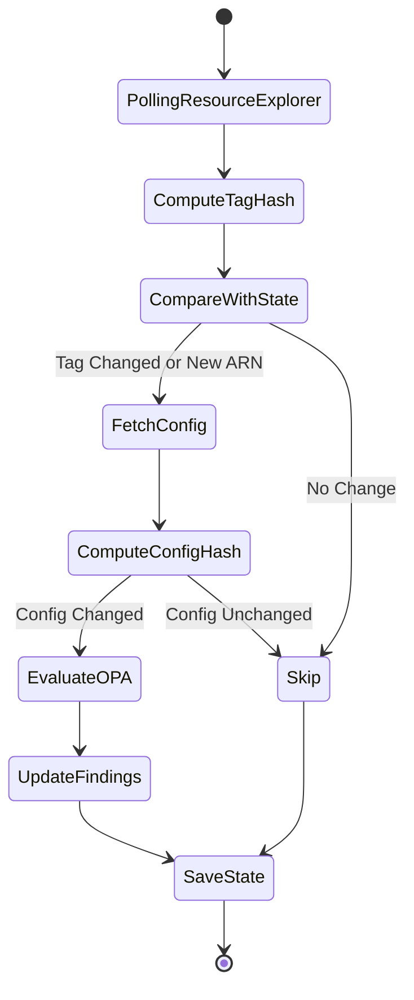

# 03 Delta Scan Deep Dive

## TL;DR
- **Goal**: Quickly detect configuration changes without pulling the entire cloud graph.
- **Triggers**: Scheduled via Celery Beat (polling AWS Resource Explorer + AWS Config).
- **Hashing**: SHA-256 on normalized JSON dictionaries (keys sorted) to detect changes.
- **State Storage**: Hashes are stored in Valkey/Redis via `state.py`.
- **Policy Engine**: Changed resources are immediately evaluated against OPA.

## Goal & Definition
A **Delta Scan** (referred to internally as "inventory pull") is a fast, incremental scan. Unlike a Deep Scan (which builds a massive graph using Cartography), the Delta scan identifies *only what has changed* since the last run. This reduces AWS API calls, cost, and scan duration.

## Trigger Mechanisms
**Not found in codebase**: EventBridge, CloudWatch Events, CloudTrail triggers, or SNS/SQS event-driven architectures.
**Instead**: The system uses a polling mechanism (`worker/jobs/inventory/aws.py`). Celery Beat periodically triggers `periodic_inventory_pulls`. 

The polling process involves:
1. `poll_resource_explorer()`: Queries AWS Resource Explorer 2 (`search_resources_page`) to get all ARNs and their tags.
2. `collect_changed_arns_from_config()`: Queries AWS Config (`select_resource_config`) using a SQL-like expression (`configurationItemCaptureTime > '...'`) to find recent configuration changes.

## Resource Configuration Collection
- Uses AWS Resource Explorer for a global view of ARNs.
- Uses `boto3` paginated calls to fetch the full configuration only for ARNs whose hashes have changed.
- Defined in `FETCHER_MAP` (`worker/jobs/inventory/fetchers`). 
- Rate limiting is handled via `@with_backoff(max_attempts=5)` (`throttle.py`).

## Normalization and Hashing
Hashing is implemented in `backend-fastapi/worker/jobs/inventory/hashing.py`.
- **Algorithm**: SHA-256 (`hashlib.sha256()`).
- **Target**: Dictionaries are normalized using `_normalise(config)` which sorts dictionary keys alphabetically and sorts lists by their string representation.
- **Serialization**: `json.dumps(obj, sort_keys=True, default=str)`.
- **Hashes Computed**: 
  - `tag_hash`: Based on ARN, type, region, and sorted tags.
  - `config_hash`: Based on ARN and full normalized configuration.

```python
# hashing.py snippet
def _sha256(obj: dict) -> str:
    serialised = json.dumps(obj, sort_keys=True, default=str)
    return hashlib.sha256(serialised.encode("utf-8")).hexdigest()
```

## Change Detection Algorithm
1. `load_hashes(account_id)` fetches the previous state from PostgreSQL/Redis.
2. `compute_delta()` separates ARNs into:
   - **New**: In current, not in previous.
   - **Deleted**: In previous, not in current.
   - **Changed**: Tag hash differs.
3. For new and changed ARNs, the full config is fetched and `config_hash` is computed. If `config_hash` differs, the resource has drifted (`has_config_drifted`).

## State Storage
Baseline snapshots and hashes are managed by `state.py`.
- `load_hashes()` and `save_hashes()` interact with PostgreSQL (via `repo.save_hashes` / `repo.load_hashes`).

## What Happens After a Change is Detected
1. The new configuration is upserted into PostgreSQL (`repo.upsert_resource_config`).
2. A minimal node is written to Neo4j (`write_resource_to_neo4j`).
3. The resource is passed to the rule engine (`worker.jobs.rule_engine.evaluator.evaluate_resource`), which calls OPA.
4. Findings are opened, closed, or updated based on the OPA evaluation.
5. Deletions result in a `tombstone_resource()` call in Neo4j and marked deleted in Postgres.

## Configuration
| Config Key | Default | Effect |
| --- | --- | --- |
| `enable_s3_fallback_discovery` | false (assumed) | If true, lists S3 buckets directly via Boto3 as a fallback. |
| `enable_aws_config_drift` | false (assumed) | If true, polls AWS Config for drift signals. |
| `aws_config_initial_lookback_minutes` | 180 | Lookback period for AWS Config queries. |

## Diagrams

### Delta Scan State Machine

> **Caption**: State machine illustrating the lifecycle of a resource ARN during a Delta Scan.
