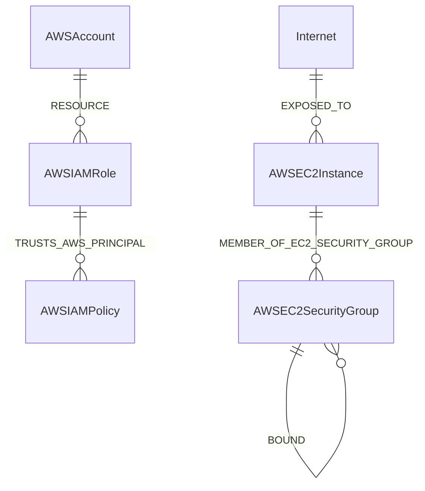
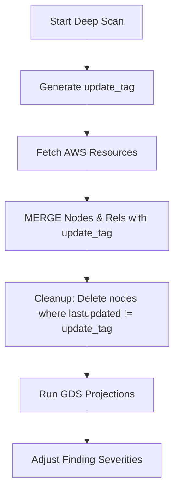

# 05 Deep Scan, Neo4j, Cartography, and GDS

## TL;DR
- **Deep Scan**: Manually triggered, builds a full relationships graph of the AWS environment.
- **Cartography**: Python library used for ingestion (`backend-fastapi/worker/jobs/deep_scan/aws/aws.py`).
- **Neo4j**: Graph database storing nodes (resources) and relationships.
- **Graph Data Science (GDS)**: Used to adjust finding severities dynamically based on network centrality (PageRank, Betweenness).

## Deep Scan Definition
A Deep Scan is a comprehensive ingestion of cloud resources and their relationships. Unlike Delta Scans, it executes Cartography sync jobs, updating the entire graph model and executing Graph Data Science (GDS) analytics. Scope includes AWS Organizations, IAM, EC2, S3, RDS, etc.

## Cartography
Cartography is embedded as a library (`cartography.intel.aws`).
- **Execution**: The `start_aws_ingestion` function (`backend-fastapi/worker/jobs/deep_scan/aws/aws.py:L26`) configures a boto3 session, gathers regions, and executes `_sync_all_services`.
- **Enabled Modules**: Organization, EC2, IAM, S3, RDS, KMS, ECR, Lambda, etc.
- **Lifecycle**: Uses `update_tag` to mark newly synced nodes. Nodes missing the `update_tag` post-sync are cleaned up using `cartography_aws.run_cleanup_job`.

## Neo4j
- **Edition**: Neo4j 5 Community Edition (local) or AuraDB.
- **Deployment**: Defined in `docker-compose.yml`. Must have the `graph-data-science` plugin installed.
- **Queries**: Uses Cypher with `MERGE` and `UNWIND` (standard Cartography behavior).

## Graph Data Science (GDS)
**Yes, Graph Data Science IS used in this codebase.**
Defined in `backend-fastapi/worker/jobs/deep_scan/graph_analytics.py`.

### Algorithms Used:
1. **PageRank (`gds.pageRank.write`)**: Identifies highly central or highly connected resources. Modifies `pagerank_score`.
2. **Betweenness Centrality (`gds.betweenness.write`)**: Identifies "chokepoint" nodes that bridge different parts of the network. Modifies `betweenness_score`.
3. **Louvain (`gds.louvain.write`)**: Community detection. Identifies clusters (e.g., blast radius). Modifies `community_size`.
4. **K-Core (`gds.kcore.write`)**: Evaluates density of the network around a node. Modifies `core_value`.
5. **WCC (Weakly Connected Components) (`gds.wcc.write`)**: Identifies isolated components and bridging nodes (`is_bridge`).
6. **Shortest Path (Dijkstra)**: Used to calculate `hops_from_internet`.

### How GDS is Used
The function `compute_adjusted_severity()` (`backend-fastapi/worker/jobs/deep_scan/graph_analytics.py:L24`) bumps the severity of a finding if the resource is critical in the graph:
- PageRank > 0.7 -> Severity + 1 ("high_centrality")
- Betweenness > 500 -> Severity + 1 ("chokepoint")
- Hops from internet <= 2 -> Severity + 1 ("internet_exposed")
- Community size > 5 -> Severity + 1 ("large_blast_radius")

## Relationship to Policy Engine
Graph context does not get passed directly into OPA. Instead, OPA computes a static `base_severity`. Post-evaluation, if the finding is open, the GDS logic adjusts the final severity upward based on the graph metrics.

## Diagrams

### Graph Schema (ER)

> **Caption**: Simplified ER Diagram showing relationships between AWS accounts, IAM entities, EC2 instances, and the internet in Neo4j.

### Cartography Sync Lifecycle

> **Caption**: Flowchart showing how Cartography syncs data, cleans up stale nodes, and triggers GDS.
